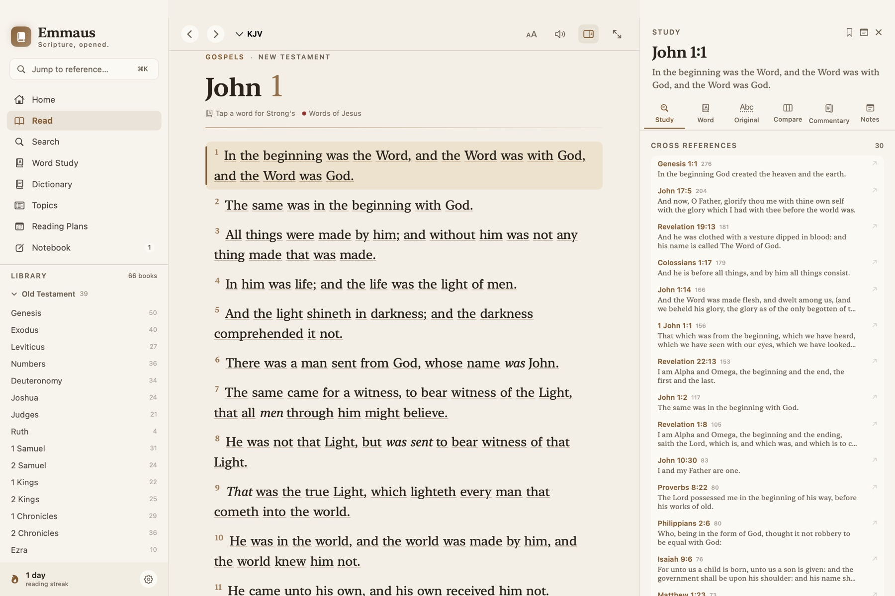
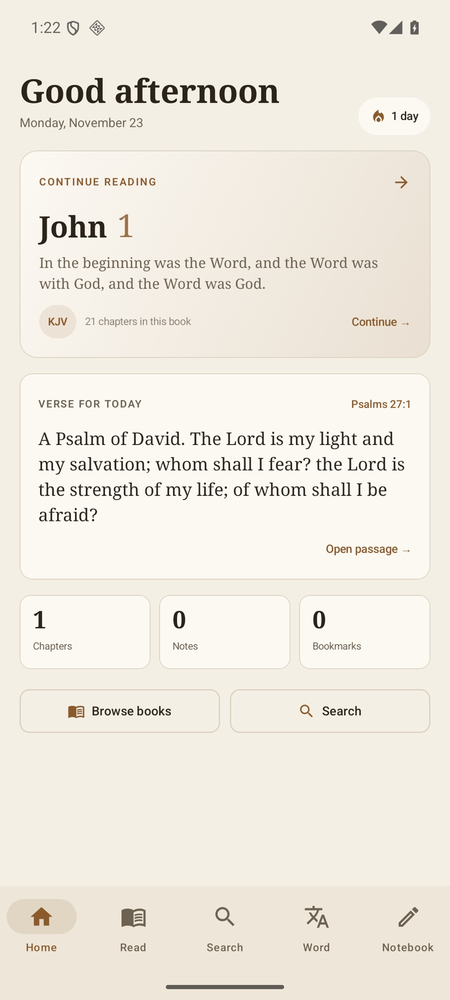
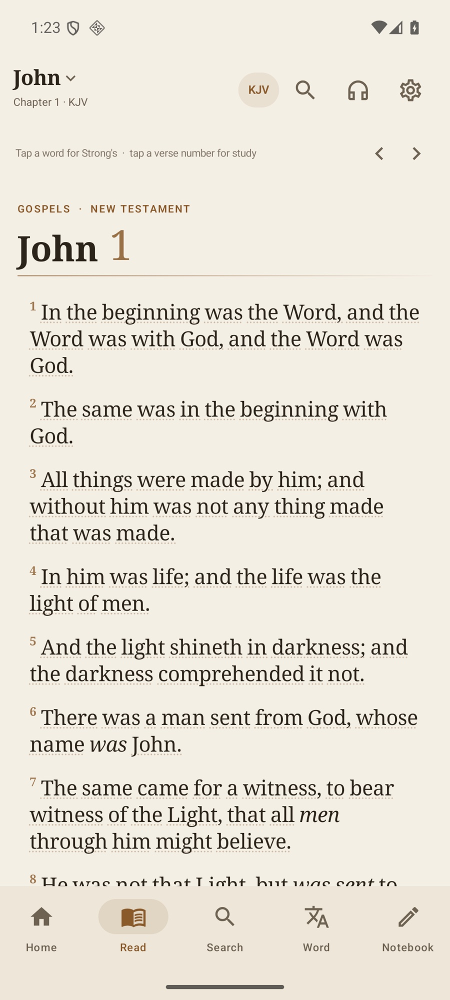
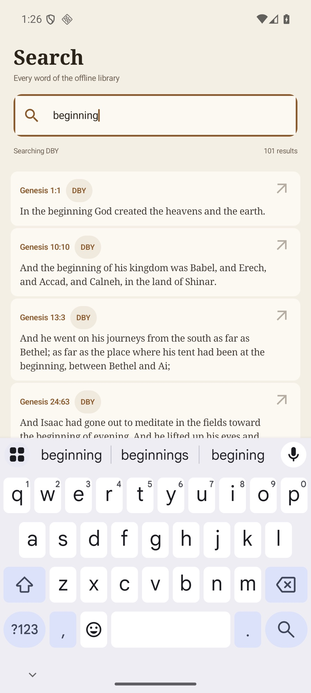
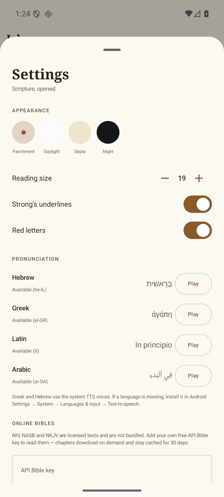

<div align="center">

# Emmaus

**Scripture, opened.**

A free, offline-first study Bible for macOS and Android.
41 translations, the original languages, 344,000 cross-references, and a real
study desk — on your own device. No account. No ads. No subscription.

[](LICENSE)
[](#download)
[](#the-library)
[](#project-status)
[](CONTRIBUTING.md)

[The library](#the-library) · [Screenshots](#screenshots) · [Download](#download) · [Contributing](CONTRIBUTING.md) · [Roadmap](#roadmap)

</div>



## What this is

Emmaus is a study Bible, not a reading app with a verse-of-the-day bolted on. The
entire library lives on your device, so it works on a plane, in a basement, or
wherever the signal isn't. Open a chapter and the study desk is one click away:
cross-references, commentary, the Hebrew and Greek behind every word, a lexicon,
and a place to write.

It is built for the kind of reading where you stop and ask *what does that word
mean, and where else does it appear?*

## The promise

**Emmaus is free. Not free-trial, not freemium, not free-with-an-account.**

- **No paid tier.** Every feature is in the free app.
- **No accounts.** Nothing to sign up for, nothing to log in to.
- **No ads, ever.** Not now, not "later, to support development".
- **No telemetry.** The app does not phone home. Your reading stays on your device.
- **No AI rewriting scripture.** The text is the text.

This is a covenant, not a marketing line. Contributions that add advertising,
tracking, paywalls, or a required account will be declined — see
[CONTRIBUTING.md](CONTRIBUTING.md).

> If someone forks this project and adds ads or a subscription, that fork is not
> Emmaus, and it may not use the name or the icon.

## The library

**41 offline translations, 1.19 million verses.** All public domain or openly
licensed, all bundled, all searchable.

| | |
|---|---|
| **English (13)** | KJV with Strong's and red letters, BSB, WEB, ASV, YLT, BBE, Darby, Douay-Rheims, Geneva 1599, Majority Standard, Revised Version 1885, Webster, World Messianic |
| **Original languages (6)** | Hebrew (Westminster Leningrad Codex), Greek New Testament, Textus Receptus, Byzantine Textform, Clementine Vulgate, Arabic Van Dyck |
| **Chinese** | Union Version, simplified and traditional |
| **Spanish · French · German · Portuguese · Italian** | Reina Valera 1909, Louis Segond 1910, Luther 1912, World Portuguese, Riveduta 1927 |
| **Russian · Ukrainian · Serbian · Czech · Romanian · Dutch** | Synodal, Kulish, Daničić-Karadžić 1868, Kralická 1613, 1924, 1917 |
| **Korean · Japanese · Vietnamese · Thai · Burmese · Persian** | 1910, Freedom Bible, 1923, Freedom Bible, Common Language, Old Persian Version |
| **Esperanto · Hawaiian · Haitian Creole** | 1926, 1868, 1985 |

Plus, with your own free [API.Bible](https://api.bible) key: **NIV, NASB, and NKJV**,
downloaded chapter by chapter and cached on your device. Nothing copyrighted is
shipped in the app.

## What you can do

| Study | Notes | Reading |
|---|---|---|
| **Interlinear** — Hebrew and Greek word by word, with morphology | **Verse notes** — written in place, kept locally | **Reading plans** — Bible in a year, NT in 90 days, Gospels in 60, Psalms & Proverbs in 31, Paul in 30, Wisdom in 30 |
| **Word study** — Strong's, BDB-style Hebrew, Abbott-Smith/LSJ Greek | **Five highlight colours** and bookmarks | **Streaks and progress** across every plan |
| **Every occurrence** — concordance for each Strong's number | **Markdown export** of everything you've written | **Full-text search** — phrase, prefix, and reference |
| **344,000 cross-references** ranked by votes | **Translation compare** — read a verse in every version at once | **⌘K** — jump to any reference instantly |
| **Commentary** — Matthew Henry, Jamieson-Fausset-Brown, Geneva, Scofield, Tyndale Open Study Notes | | **Pronunciation** — text-to-speech for Hebrew, Greek, Latin, and Arabic |
| **Reference** — Easton, Smith, Hitchcock, Nave's Topical Bible | | |

## Screenshots

<table>
<tr>
<td align="center"><br><sub>Home — continue reading, streaks</sub></td>
<td align="center"><br><sub>Reader — KJV with Strong's</sub></td>
<td align="center"><br><sub>Search — every word, offline</sub></td>
</tr>
<tr>
<td align="center"><br><sub>Chinese Union Version</sub></td>
<td align="center"><br><sub>Settings — bring your own key</sub></td>
<td align="center"><br><sub>macOS — reader + study panel</sub></td>
</tr>
</table>

## Download

| Platform | Status | How |
|---|---|---|
| **macOS 14+** | Beta | Build from source (below). A notarized `.dmg` needs an Apple Developer account — [help wanted](#good-first-issues). |
| **Android 8+** | Alpha | Sideload the APK from [Releases](../../releases), or build it (below). |

Both platforms are the same idea in native toolkits: SwiftUI on the Mac, Kotlin +
Compose on Android. No Electron, no web view, no shared runtime.

The Android app is an early alpha. It reads, searches, studies, and takes notes,
but it has not shipped to Play yet. Expect rough edges and tell us about them.

## Build from source

**The Bible library is not in this repository.** It is 454 MB of public-domain
text, generated from the sources rather than committed. You need it before the
app will start.

```bash
git clone https://github.com/helioryn/emmaus.git
cd emmaus

# 1. Download the source texts (~1 GB, one time)
bash tools_download.sh

# 2. Build the database (writes Resources/bible.db)
python3 tools/import_bible.py
python3 tools/import_free_bibles.py

# 3. Run it
bash build_app.sh          # macOS: produces dist/Emmaus.app
open dist/Emmaus.app
```

macOS needs the Xcode Command Line Tools and macOS 14+. The build script targets
the installed SDK; adjust `SDK` in `build_app.sh` if yours differs.

For Android, copy the database into the app, then build:

```bash
cp Resources/bible.db android/app/src/main/assets/bible.db
cd android && ./gradlew :app:assembleDebug
```

See [ANDROID-TESTING.md](ANDROID-TESTING.md) for signing and installing a release
build.

## Project status

| | |
|---|---|
| **macOS** | Feature-complete beta. Reader, study desk, word study, notes, plans, search, TTS. |
| **Android** | Alpha. Reader, study sheet, word study, notes, plans, search. |
| **iOS** | Not started. |
| **Sync** | Not built. Personal data is local-only, exportable as JSON and Markdown. |

Emmaus is maintained by one developer. That is the honest reason features arrive
in order rather than all at once — and the reason contributions are genuinely
useful, not ceremonial.

## Roadmap

- [ ] Notarized macOS `.dmg` and a signed Android release with automatic updates
- [ ] iOS app
- [ ] Full-text search across all 41 translations on macOS (Android has it)
- [ ] Opt-in, end-to-end encrypted sync (never a required account)
- [ ] VoiceOver and TalkBack pass
- [ ] Shrink the install: on-demand translation packs instead of one 454 MB database
- [ ] More public-domain translations, as licenses allow

Have a look at the [open issues](../../issues) — anything labelled
`good first issue` is scoped to be finishable in an evening.

Project policies: [Contributing](CONTRIBUTING.md) ·
[Code of Conduct](CODE_OF_CONDUCT.md) · [Security](SECURITY.md) ·
[Data licenses](DATA-LICENSES.md) · [License](LICENSE)

## Contributing

Contributions are welcome: code, translations, documentation, test reports,
accessibility fixes, and bug triage. Read [CONTRIBUTING.md](CONTRIBUTING.md)
first — it covers the build, the review process, and the rules that keep this
project healthy.

<a id="good-first-issues"></a>
**Good first issues:** notarization, a macOS full-text index for the newer
translations, Linux-friendly scripts in `tools/`, accessibility labels, and extra
tests around navigation state.

## Data, licenses and attribution

The **code** is [GPL-3.0](LICENSE): you may use, study, share, and modify it, and
derivatives must remain free. The **name and icon** are not covered by that
license; forks must use their own name.

The **Scripture and reference data** come from many sources with their own terms.
Public-domain texts are unrestricted. Others require attribution — STEPBible
lexicons and morphology are CC BY 4.0, openbible.info cross-references are CC BY,
the Open Scriptures Strong's dictionaries are CC BY-SA, and Tyndale Open Study
Notes are CC BY-SA. The app displays the required notices.

Every source, license, and attribution string is documented in
[DATA-LICENSES.md](DATA-LICENSES.md). If you add a translation or dataset, you must
document it there in the same pull request.

## Privacy

Emmaus has no analytics, no crash reporting service, and no server. Notes,
highlights, bookmarks, and reading history live in a SQLite file in your app
support directory. If you add an API.Bible key, the key and the chapters you fetch
stay on your device; requests go directly from your computer or phone to
`rest.api.bible`, and cached chapters are refreshed every 30 days as the
publisher's terms require.

## Acknowledgements

Emmaus stands on work done by others and given away freely: the
[STEPBible](https://github.com/STEPBible/STEPBible-Data) project at Tyndale House
Cambridge, [Open Scriptures](https://github.com/openscriptures),
[openbible.info](https://www.openbible.info/), [eBible.org](https://ebible.org/),
the [scrollmapper](https://github.com/scrollmapper/bible_databases) datasets, and
[API.Bible](https://api.bible) from the American Bible Society for making licensed
translations reachable by small developers.

And to the translators, mostly unnamed, who did the work centuries before any of
us were born.

---

<div align="center">

**Soli Deo gloria.**

</div>
