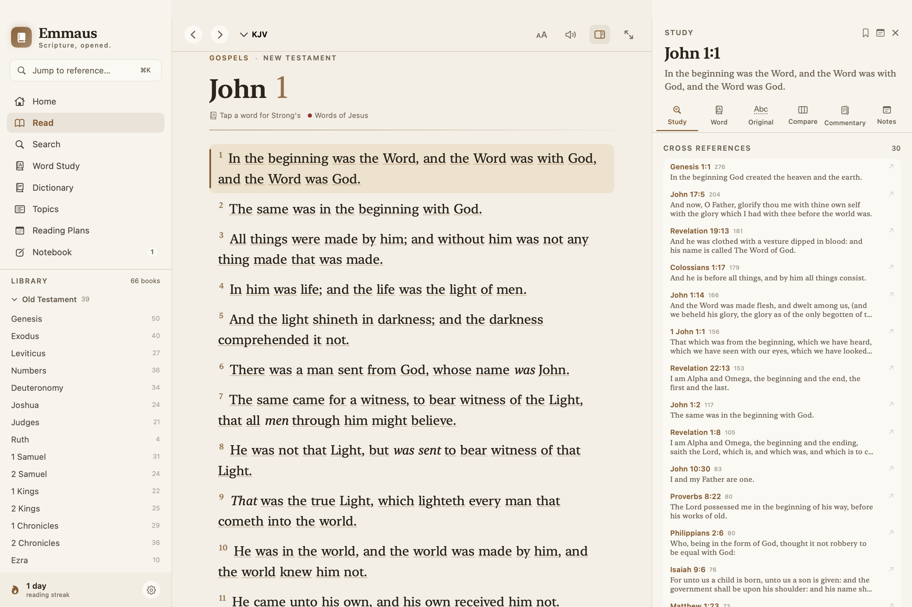

# Emmaus

**Scripture, opened.**

A native macOS study Bible for deep reading and research.



## What is inside

- **Reader** — KJV (Strong’s, morphology, precise red letters), Berean Standard Bible, World English Bible, ASV, Young’s Literal Translation, Hebrew (Westminster Leningrad Codex), Greek New Testament, Textus Receptus, Byzantine Textform, Clementine Vulgate, and Arabic Van Dyck.
- **Connected Bibles** — NIV, NASB, and NKJV through API.Bible. Chapters are fetched on demand and cached within the API’s rules. The full licensed texts are not bundled.
- **Study panel** — 344,000 cross-references, commentary (Matthew Henry, Jamieson–Fausset–Brown, Geneva, Scofield, Tyndale Open Study Notes), original-language interlinear, translation comparison, and verse notes.
- **Word study** — Strong’s Hebrew and Greek, BDB-style Hebrew, Abbott-Smith/LSJ Greek, morphology, concordance, and every KJV occurrence.
- **Reference** — Easton, Smith, Hitchcock, and Nave’s Topical Bible.
- **Pronunciation** — per-word text-to-speech for Hebrew, Greek, Latin, and Arabic, with slow playback and transliteration.
- **Notebook** — notes, five highlight colors, bookmarks, and Markdown export.
- **Reading plans** — Bible in a year, New Testament in 90 days, Gospels in 60, Psalms & Proverbs in 31, Paul in 30, and Wisdom in 30, with progress and streaks.
- **Search and command palette** — full-text search, phrase and prefix search, and instant references with ⌘K.

## Run it

```bash
open dist/Emmaus.app
```

The app stores personal data in `~/Library/Application Support/Emmaus/`.

## Build it

```bash
bash build_app.sh
```

Requires macOS 14 or newer and the Xcode Command Line Tools. Because the installed Command Line Tools ship SwiftUI macros without the matching plugin, this project builds against the `MacOSX26.5.sdk` SDK that is already present on this machine.

The build script:

1. Builds the release binary.
2. Copies the Bible library and icon into `dist/Emmaus.app`.
3. Writes the API.Bible configuration from `.env` to `~/Library/Application Support/Emmaus/config.json` with mode `0600`.
4. Ad-hoc signs the app.

## API.Bible

`.env` format:

```text
API ENDPOINT - https://rest.api.bible
API KEY - your-key
```

The key is never hard-coded into the source. NIV, NASB, and NKJV are requested chapter-by-chapter with your key. Cached chapters are capped at 480 verses and refreshed after 30 days, and the copyright notice returned by API.Bible is shown in the reader.

## Data and licenses

- KJV with Strong’s and red letters: Open Scriptures / public domain.
- BSB, ASV, YLT, WEB, WLC, Vulgate, Arabic Van Dyck: public domain.
- STEPBible TAHOT/TAGNT, TBESH/TBESG, and morphology: CC BY 4.0, Tyndale House Cambridge.
- Open Scriptures Strong’s dictionaries: CC BY-SA.
- openbible.info cross-references: CC BY.
- Matthew Henry, Jamieson–Fausset–Brown, Geneva, Scofield: public domain.
- Tyndale Open Study Notes: CC BY-SA.
- Easton, Smith, Hitchcock, Nave’s: public domain.

MacArthur’s study notes are copyrighted and are not bundled. The Study panel links to Grace to You and other teachers for the current passage.
